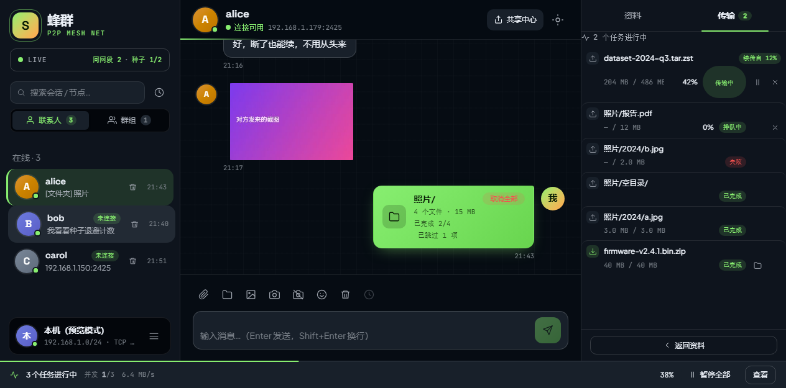

# 第一次打开

第一次打开，你什么都不用填，直接就能用。

整个窗口分三块：

| 区域 | 作用 |
|---|---|
| **左边** | 搜索框、联系人和群组列表、你自己的状态 |
| **中间** | 聊天和发文件的地方 |
| **右边** | 对方的资料，或者正在传输的文件列表 |

## 心跳灯

左上角的心跳灯显示你现在的连接状态，正常情况下是绿色 **LIVE**。

它变红或变灰时，通常不是软件坏了，而是网络层出了问题：网卡没连上、端口被防火墙挡住、或者种子地址不通。按顺序看这两处：

1. 左下角头像 → **调试面板**：找到了几个节点、正连着几个、种子通没通，一眼能看到；
2. 设置 → **部署自检**：让它逐项跑一遍，直接告诉你是哪一段断了。

## 列表是空的？

这是新用户最常见的疑问。原因几乎都在网络发现上，见[别人怎么出现在列表里](./peers.md)。
