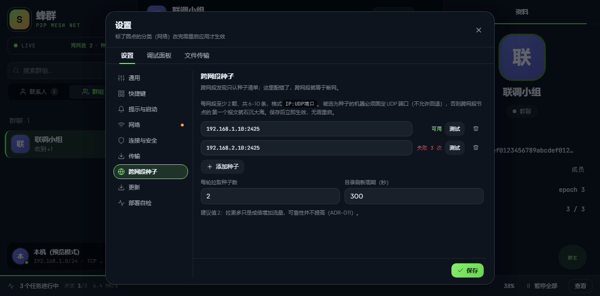
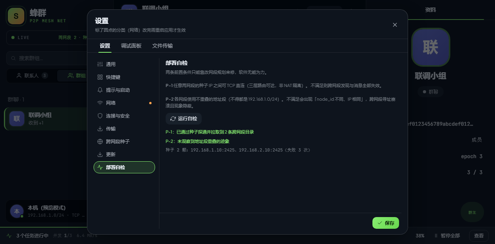
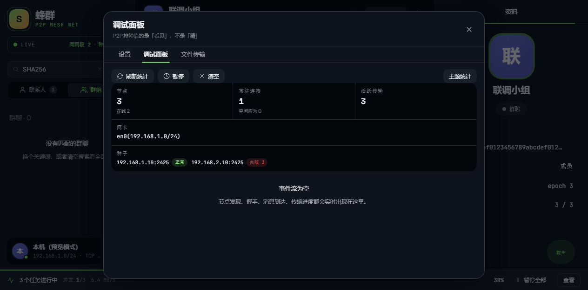

# 别人怎么出现在列表里

大多数情况下不需要任何操作：**同一个网络里的电脑，几秒钟内就会自动出现在你的联系人列表里**，像走进同一个房间自然看到彼此。

## 三种状态灯

每个名字前面的小圆点代表对方此刻的状态：

| 灯 | 含义 | 能做什么 |
|---|---|---|
| 🟢 绿 | 在线 | 可以聊天、发文件 |
| 🟡 黄 | 仅限同网段 | 能聊天，但跨网段的路由还没通 |
| 🔴 红 | 离线 | 对方关机、断网，或换了网络 |

**黄灯是最容易被忽略的一种**：它看起来像「在线」，实际上只走本地广播，跨楼层的人收不到。看到黄灯就去配种子。

## 跨网段：配一次「种子」

不同楼层的网络通常是隔开的，自动发现到不了。这时用**种子**把两段网络接起来：

1. 点左下角自己的头像 → 设置 → **跨网段种子**；
2. 点 **添加种子**；
3. 填上对方电脑的地址和端口（格式 `IP:端口`，例如 `192.168.1.8:2425`）；
4. 点 **测试**，显示「可用」就通了。

种子地址从哪来？让对方在自己的「跨网段种子」页面里复制给你，支持批量导入。种子清单**改完保存即生效**，不需要重启软件。

::: tip 测试按钮会给你两跳结果
它分别报 UDP 与 TCP。跨网段最常见的故障正是「UDP 通、TCP 被防火墙挡住」—— 只有 UDP 通的时候，你能看到人，但发不出消息。
:::

## 通不通，让自检告诉你

不确定网络哪里断了，点设置里的 **部署自检** → 运行自检。它会逐项检查并直接指到出问题的那一段，而不是只给一句「连接失败」。

自检的具体判定规则与现场部署条件，见[部署前必读](../deploy/index.md)。

## 看不到人时的排查顺序

1. 对方真的开着软件吗？对方的状态灯是红色吗？
2. 你和对方是不是在**同一网段**？（黄灯就是「不是」）
3. 跨网段的话，种子加了吗？种子「测试」通过了吗？
4. 打开**调试面板**：找到几个节点、连着几个、种子通没通、用的哪块网卡 —— 大部分「连不上」看一眼就明白了。

::: tip 调试面板
左下角自己的头像 → **调试面板**。写着「失败」的项就是断点所在。

:::
