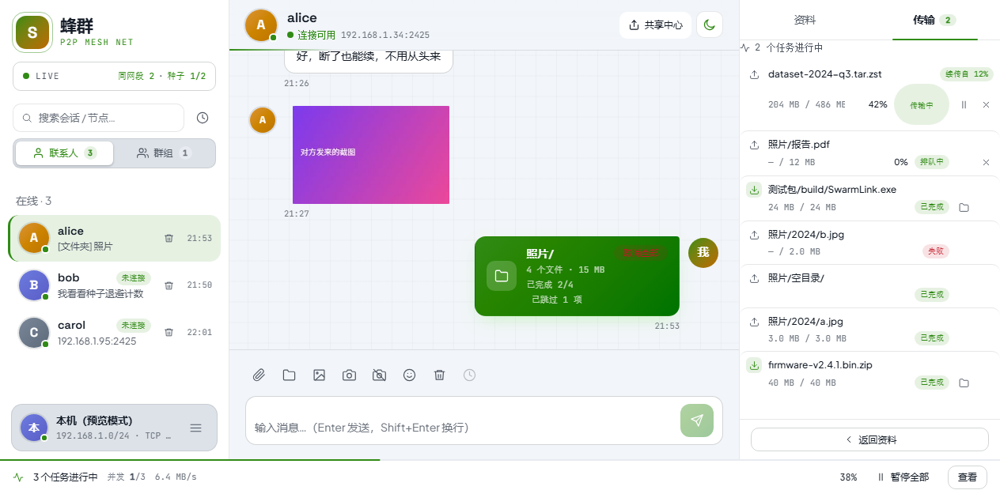
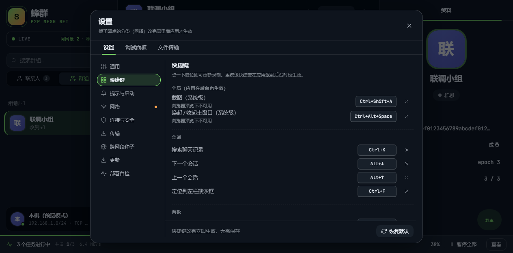

# 个性化与快捷键

## 深色 / 浅色主题

默认跟随系统。想手动切换，点左下角自己的头像 → 设置 → 通用，或标题栏的主题按钮。

## 换张背景图

设置 → 通用 → 背景图，选一张自己喜欢的图片，整个窗口都会以它为背景。

## 快捷键

不用背。忘了随时按 **Ctrl + /** 打开「快捷键一览」：

最常用的几个：

| 快捷键 | 作用 |
|---|---|
| `Ctrl + Shift + A` | 截图（应用在后台也有效） |
| `Ctrl + Alt + 空格` | 唤出 / 收起主窗口 |
| `Ctrl + K` | 搜索聊天记录 |
| `Ctrl + J` | 文件传输面板 |
| `Ctrl + Shift + H` | 共享中心 |
| `Ctrl + ,` | 设置 |
| `Alt + ↑ / ↓` | 切换上 / 下一个会话 |
| `Ctrl + /` | 快捷键一览 |

### 改成自己顺手的组合

设置 → 快捷键，点一下某个键位就能重新录制：

- `Backspace` 清除绑定，允许某个快捷键留空；
- 表内重复会当场拒绝；
- 「恢复默认」一键回到出厂键位；
- 改完立即生效，不需要点保存。

如果某个键位被 QQ、微信、输入法等程序占用，这一行会被标明 —— 但这不影响蜂群自己的按键生效，只是可能抢不到系统级的那次触发。

## 搜索聊天记录

按 **Ctrl + K**，输入关键词（中文两个字就能搜），点一下结果直接跳到那条消息。

记录只存在你自己的电脑里，随时可查，也随时可以跟着数据目录一起删掉。搜索范围是**本机全部会话**，包括群聊。
